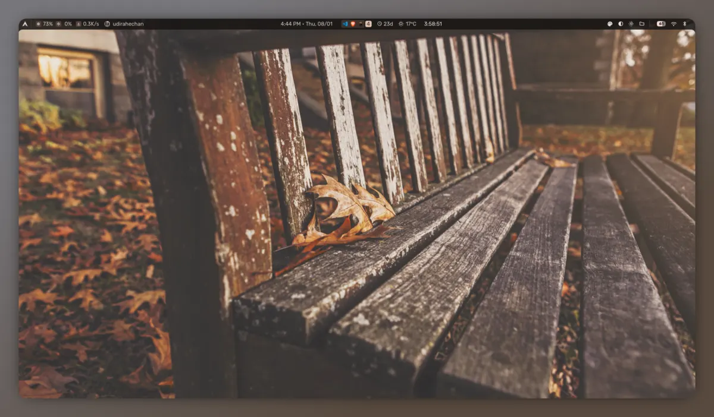

# Uses

Tools, gear, and software I rely on.

## Hardware

- Laptop - [Asus TUF Gaming A15](https://nagmani.com.np/asus-tuf-gaming-a15-fa506ncq-15-6-fhd-amd-r7-170-16gb-ddr5-512gb-pcie-g4-ssd-rtx-3050-price-in-nepal)
  - AMD Ryzen 7 6800H (16) @ 4.79 GHz
  - 16 GB DDR5 RAM
  - 512 GB NvMe SSD
  - Display (CMN153C) -> 1920x1080 in 15", 144 Hz ]
- GPU - NVIDIA GeForce RTX 3050 Ti Mobile [D]
- Inputs (Mouse/Keyboard)
  - [Logitech G203 LIGHTSYNC Gaming Mouse](https://www.logitechg.com/en-us/products/gaming-mice/g203-lightsync-rgb.910-005793.html), ~~[Fantech VX7V2 Crypto II Mouse (Wired)](https://www.daraz.com.np/products/fantech-mouse-vx7v2-crypto-ii-wired-gaming-mouse-with-rgb-lighting-effects-6-macro-function-i339873311-s1499906871.html)~~
  - [Fantech ATOM96 MK890 V2 Keyboard (Mizu Edition)](https://www.daraz.com.np/products/fantech-atom96-mk890-v2-mizu-edition-wired-mechanical-gaming-keyboard-rgb-backlit-3-color-keycaps-adjustable-feet-hot-swappable-switches-i132775528-s1047457439.html)
- Phone - [Samsung Galaxy S22 Ultra](https://www.samsung.com/np/smartphones/galaxy-s22-ultra-5g-sm-s908bzkgdnp/), ~~[Redmi Note 11 Pro 5G ](https://www.mi.com/np/product/redmi-note-11-pro-5g/)~~ - bought in 2023
- Headphone - [JBL Tune 720BT - black](https://www.jbl.com/TUNE720BT.html)
- Airbuds - [JBL Buds 2](https://www.jbl.com/Buds-2.html), ~~[Ultima ATOM 255](https://www.gadgetbytenepal.com/product/ultima-atom-255-price-nepal/)~~
- Speaker - [Asta Wolf Banger](https://www.gadgetbytenepal.com/product/asta-wolf-banger/)

## Software

### Fundamentals
- Development - [VS Code](https://code.visualstudio.com), [Cursor](https://cursor.com), [OpenCode](https://opencode.ai)
- Browser - [Brave Origin](https://brave.com/origin/) (mostly), [Firefox](https://www.mozilla.org/firefox/), ~~[Zen Browser](https://zen-browser.app)~~, ~~[Brave](https://brave.com)~~
- OS - [Omarchy](https://omarchy.com), ~~[Linux (Arch)](https://archlinux.org)~~, ~~[Omarchy](https://omarchy.com)~~, ~~[FEDORA](https://fedoraproject.org)~~, ~~[UBUNTU](https://ubuntu.com)~~
- WM - [Niri](https://github.com/YaLTeR/niri), ~~[Hyprland](https://hyprland.org)~~
- Shell - [fish](https://fishshell.com)
- Terminal - [Kitty](https://sw.kovidgoyal.net/kitty/)
- Prompt - [Starship](https://starship.rs)

### Languages & Frameworks
- Python - [PyTorch](https://pytorch.org), [Transformers](https://huggingface.co/docs/transformers), [LangChain](https://www.langchain.com), [LangGraph](https://langchain-ai.github.io/langgraph/), [FastAPI](https://fastapi.tiangolo.com), [Streamlit](https://streamlit.io), [scikit-learn](https://scikit-learn.org), [Pandas](https://pandas.pydata.org), [NumPy](https://numpy.org)
- TypeScript - [Next.js 14](https://nextjs.org), [Tailwind CSS](https://tailwindcss.com), [shadcn/ui](https://ui.shadcn.com)
- Documentation - [Obsidian](https://obsidian.md), ~~[Notion](https://www.notion.so)~~, [Typst](https://typst.app), ~~[LaTeX](https://www.latex-project.org)~~, [Markdown](https://www.markdownguide.org)

### DevOps & Cloud
- [Docker](https://www.docker.com), [Git](https://git-scm.com), [GitHub](https://github.com), [AWS](https://aws.amazon.com)

### No-Code / Automation
- [Bubble.io](https://bubble.io), [Glide](https://www.glideapps.com), [Zapier](https://zapier.com), [Xano](https://xano.com), [Airtable](https://www.airtable.com), [n8n](https://n8n.io)

Take a look at my [dotfiles](https://github.com/paudelsamir/dotfiles).

Curious about other uses pages? Check out [uses.tech](https://uses.tech).

for context see my [about](/about/). check [bookmarks](/bookmarks/) for inspiration and [learning](/learning/) for resources.

